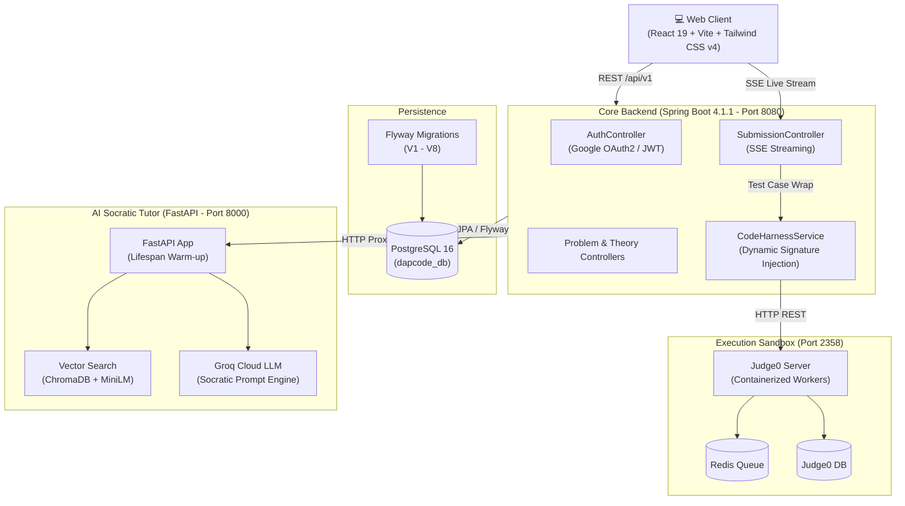

# ♿ LiệtCode (LietCode)

<p align="center">
  
</p>

<p align="center">
  <b>Next-Generation Competitive Programming & DSA Mastery Platform with Socratic AI Tutoring</b>
</p>

<p align="center">
  <a href="README.vi.md">🇻🇳 <b>Bản Tiếng Việt</b></a> •
  <a href="HOW_TO_RUN.md">🚀 <b>Quickstart & Run Guide</b></a> •
  <a href="#-architecture">🏗️ <b>Architecture</b></a> •
  <a href="#-tech-stack">⚡ <b>Tech Stack</b></a>
</p>

<p align="center">
  
  
  
  
  
  
  
  
</p>

---

## 🌟 Overview

**Dapcode** (*Vietnamese: "Đập Code" — crushing coding challenges*) is a modern, full-stack algorithmic learning platform. Inspired by LeetCode and NeetCode, Dapcode blends interactive problem-solving, structured roadmaps, sandboxed multi-language code execution, and an **intelligent Socratic AI tutor** that guides learners through intuition and hints without giving away answers.

---

## ✨ Key Features

### 1. 🧠 Socratic AI Tutor (RAG + Groq)
- **Guided Learning**: Built on the Socratic method—refuses to output raw solutions; instead asks probing questions, suggests edge cases, and guides algorithmic complexity step-by-step.
- **Context-Aware Retrieval**: Combines problem metadata, NeetCode solution patterns, user's live editor code, and previous conversation turns into vector embeddings (ChromaDB + `all-MiniLM-L6-v2`).
- **Sub-Second Streaming**: Low-latency inference powered by Groq LLM API.

### 2. ⚡ LeetCode-Grade Coding Workspace
- **Monaco Code Editor**: Professional-grade IDE experience with syntax highlighting, autocomplete, and hotkeys for C++, Java, and Python 3.
- **Dynamic Starter Templates**: Automatically initializes language-specific function signatures and starter boilerplate for over 250 problems.
- **Universal Code Harness**: Intelligent reflection driver supporting vectors, multidimensional matrices, targets, strings, and custom test archetype wrappers.

### 3. 🛡️ Isolated Sandboxed Execution (Judge0 CE)
- **Multi-Language Support**: C++ (GCC 13), Java 21 (OpenJDK), Python 3.11+.
- **Real-Time Streaming**: Server-Sent Events (SSE) stream test case progress (Running, Passed, Failed, Time/Memory metrics) directly to the frontend console drawer.
- **Safe Execution**: Fully containerized and resource-capped (CPU time, memory ceiling, blocked syscalls).

### 4. 🗺️ NeetCode 150/250 Interactive Roadmap
- **Visual DAG Graph**: Visual dependency tree representing topic progression (Arrays & Hashing → Two Pointers → Sliding Window → Trees → Dynamic Programming).
- **Progress Tracking**: Real-time completion badges, category statistics, and status filters.

### 5. 📚 Comprehensive DSA Theory Hub
- **29 Curated Topics**: Core data structures and algorithms explained with clean diagrams, asymptotic complexity analyses, and implementation patterns.
- **Markdown & Code Rendering**: High-fidelity dark mode reading experience.

### 6. 🔐 Auth & Learning Habits
- **Google OAuth2 & JWT**: Seamless authentication with secure HTTP-only session flows.
- **Streak & Analytics**: Tracks consecutive daily coding activity and submission success rates.

---

## 🏗️ Architecture



---

## ⚡ Tech Stack

| Layer | Technologies |
| :--- | :--- |
| **Frontend** | React 19, Vite, Tailwind CSS v4, Monaco Editor, Lucide React, Axios |
| **Backend Core** | Java 21, Spring Boot 4.1.1, Spring Security, Spring Data JPA, JJWT, Flyway |
| **AI Microservice** | Python 3.11+, FastAPI, Uvicorn, ChromaDB, Sentence-Transformers, Groq SDK |
| **Code Execution** | Judge0 CE 1.13.1, Docker, Redis, Isolated Linux Containers |
| **Database** | PostgreSQL 16 (Relational), ChromaDB (Vector Store) |

---

## 📁 Repository Structure

```text
Dapcode/
├── AI-service/             # FastAPI Socratic AI Tutor microservice
│   ├── app/                # API routers, RAG engine, Groq client
│   ├── data/               # Vector DB persistence directory
│   └── requirements.txt    # Python dependencies
├── DapcodeFrontend/        # React 19 + Vite frontend application
│   ├── src/                # Pages (Workspace, Roadmap, Theory), components
│   └── package.json        # Node dependencies
├── backend-core/           # Spring Boot 4 backend REST API
│   ├── src/main/java/      # Controllers, services, models, harness engine
│   ├── src/main/resources/ # application.yaml, Flyway migrations (V1-V8)
│   └── pom.xml             # Maven build configuration
├── infra/                  # Docker Compose orchestration
│   ├── database/           # Main PostgreSQL container setup
│   └── sandbox/            # Judge0 CE + Redis + Sandbox DB
├── seedingData/            # Python scripts for seeding problems, starter code & theories
├── HOW_TO_RUN.md           # Step-by-step developer startup guide
├── README.md               # English documentation (this file)
└── README.vi.md            # Vietnamese documentation
```

---

## 🚀 Quick Start

For detailed step-by-step instructions, please read [HOW_TO_RUN.md](file:///i:/Github/Dapcode/HOW_TO_RUN.md).

```bash
# 1. Start Infrastructure (PostgreSQL & Judge0 Sandbox)
cd infra/database && docker compose -f docker-compose.db.yml up -d
cd ../sandbox && docker compose -f docker-compose.sandbox.yml up -d

# 2. Start Backend Core (Port 8080)
cd ../../backend-core
./mvnw spring-boot:run

# 3. Start AI Socratic Tutor (Port 8000)
cd ../AI-service
python -m venv venv && source venv/bin/activate  # (Windows: venv\Scripts\activate)
pip install -r requirements.txt
uvicorn app.main:app --host 0.0.0.0 --port 8000 --reload

# 4. Start Frontend Client (Port 5173)
cd ../DapcodeFrontend
npm install
npm run dev
```

Visit `http://localhost:5173` to start coding!

---

## 📄 License

This project is licensed under the MIT License.
