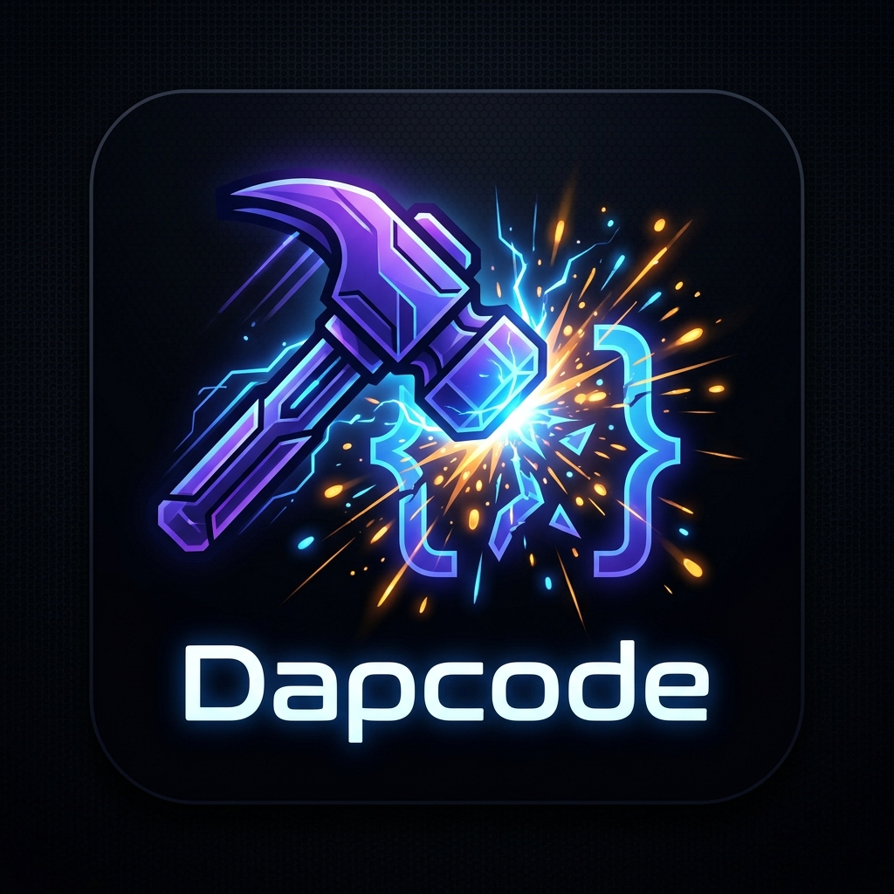
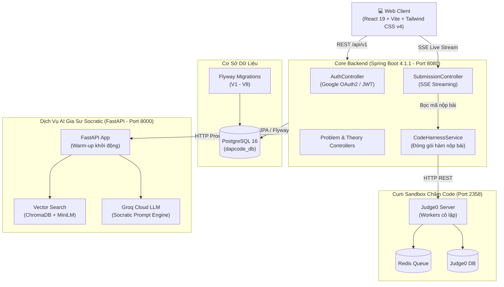

# 🔨 Dapcode (Đập Code)

<p align="center">
  
</p>

<p align="center">
  <b>Nền Tảng Luyện Thuật Toán & Cấu Trúc Dữ Liệu Tích Hợp Gia Sư Trí Tuệ Nhân Tạo Socratic AI</b>
</p>

<p align="center">
  <a href="README.md">🇬🇧 <b>English Version</b></a> •
  <a href="HOW_TO_RUN.md">🚀 <b>Hướng Dẫn Cài Đặt & Chạy</b></a> •
  <a href="#-kiến-trúc-hệ-thống">🏗️ <b>Kiến Trúc</b></a> •
  <a href="#-công-nghệ-sử-dụng">⚡ <b>Công Nghệ</b></a>
</p>

<p align="center">
  
  
  
  
  
  
  
  
</p>

---

## 🌟 Giới Thiệu

**Dapcode** ("*Đập Code*" — tinh thần phá tan mọi rào cản thuật toán khó nhằn) là nền tảng học và luyện thi thuật toán DSA full-stack hiện đại. Lấy cảm hứng từ những ưu điểm hàng đầu của LeetCode và NeetCode, Dapcode kết hợp giao diện làm bài trực quan, lộ trình đồ thị phụ thuộc DAG, hệ thống chấm mã nguồn sandbox đa ngôn ngữ, và đặc biệt là **Trợ lý AI Socratic** giúp định hướng tư duy giải quyết vấn đề mà không làm lộ đáp án (anti-spoil code).

---

## ✨ Các Tính Năng Nổi Bật

### 1. 🧠 Gia Sư AI Socratic (RAG + Groq)
- **Phương pháp Socratic**: Tuyệt đối không đưa ra code giải sẵn. Thay vào đó, AI đóng vai trò người phỏng vấn/gia sư: đặt câu hỏi gợi mở, gợi ý trường hợp biên (edge case), phân tích độ phức tạp thời gian/bộ nhớ và dẫn dắt người học từng bước đến thuật toán tối ưu.
- **Truy xuất Ngữ cảnh Thông minh (RAG)**: Tự động trích xuất thông tin bài toán, mã nguồn học viên đang viết trên Monaco Editor, lời giải mẫu từ NeetCode và lịch sử chat để nhúng vào không gian vector (ChromaDB + `all-MiniLM-L6-v2`).
- **Phản hồi Tức thì**: Tốc độ suy luận tính bằng mili-giây thông qua Groq Cloud LLM.

### 2. ⚡ Không Gian Lập Trình Chuẩn LeetCode
- **Trình soạn thảo Monaco Editor**: Trải nghiệm IDE chuyên nghiệp với tô màu cú pháp, tự động gợi ý code và phím tắt đa ngôn ngữ (C++, Java, Python 3).
- **Bộ Mã Khởi Đầu Động (Starter Code)**: Tự động tải template hàm, lớp `Solution` và kiểu dữ liệu phù hợp cho hơn 250 bài tập từ cơ sở dữ liệu.
- **Bộ Đóng Gói Mã Nguồn Tự Động (Code Harness Engine)**: Tự động phân tích kiểu tham số đầu vào (`vector<int>`, `target`, `string`, `matrix`,...) và sinh mã kiểm thử chuẩn mực cho từng test case mà không yêu cầu học viên tự viết hàm `main()`.

### 3. 🛡️ Môi Trường Chấm Code Cô Lập (Judge0 Sandbox)
- **Hỗ trợ Đa Ngôn Ngữ**: C++ (GCC 13), Java 21 (OpenJDK), Python 3.11+.
- **Luồng Dữ Liệu Thời Gian Thực**: Sử dụng Server-Sent Events (SSE) để truyền trạng thái chạy từng test case (Đang chạy, Passed, Failed, Thời gian thực thi, Bộ nhớ tiêu thụ) về thanh điều khiển của học viên.
- **An toàn Tuyệt đối**: Mã nguồn học viên chạy trong container Docker bị cô lập với giới hạn nghiêm ngặt về CPU, RAM và system call.

### 4. 🗺️ Lộ Trình Học Thuật Toán NeetCode 150/250 (DAG Visual Tree)
- **Biểu đồ Cây Phân Cấp**: Trực quan hóa lộ trình kiến thức DSA theo đồ thị định hướng không chu trình (Arrays & Hashing → Two Pointers → Sliding Window → Trees → Dynamic Programming).
- **Theo dõi Tiến độ**: Thống kê số lượng bài đã giải theo từng danh mục, đánh dấu trạng thái trực tiếp trên các nút của cây.

### 5. 📚 Thư Viện Lý Thuyết Thuật Toán Toàn Diện
- **29 Chuyên đề Chuẩn mực**: Bao quát toàn bộ kiến thức cốt lõi từ cơ bản đến nâng cao (Array, Hash Map, Binary Tree, Heap, Trie, Graph, Dynamic Programming).
- **Trình bày Markdown & Code Block Đẹp mắt**: Hỗ trợ hiển thị bảng so sánh độ phức tạp Big-O, mã giả và ví dụ minh họa trực quan.

### 6. 🔐 Bảo Mật & Thói Quen Học Tập
- **Xác thực Google OAuth2 & JWT**: Đăng nhập nhanh chóng, bảo mật token stateless qua header ủy quyền.
- **Hệ thống Chuỗi Học Tập (Streak)**: Ghi nhận số ngày luyện code liên tiếp, tạo động lực rèn luyện mỗi ngày.

---

## 🏗️ Kiến Trúc Hệ Thống



---

## ⚡ Công Nghệ Sử Dụng

| Tầng | Công nghệ |
| :--- | :--- |
| **Frontend** | React 19, Vite, Tailwind CSS v4, Monaco Editor, Lucide React, Axios |
| **Backend Core** | Java 21 LTS, Spring Boot 4.1.1, Spring Security, Spring Data JPA, JJWT, Flyway |
| **AI Microservice** | Python 3.11+, FastAPI, Uvicorn, ChromaDB, Sentence-Transformers, Groq SDK |
| **Sandbox Chấm Code** | Judge0 CE 1.13.1, Docker, Redis, Isolated Linux Containers |
| **Cơ sở Dữ liệu** | PostgreSQL 16 (Dữ liệu quan hệ), ChromaDB (Vector Store) |

---

## 📁 Cấu Trúc Thư Mục Dự Án

```text
Dapcode/
├── AI-service/             # Microservice AI Gia sư Socratic (FastAPI)
│   ├── app/                # Endpoints API, bộ máy RAG, Groq Client
│   ├── data/               # Thư mục lưu trữ cơ sở dữ liệu vector ChromaDB
│   └── requirements.txt    # Danh sách thư viện Python
├── DapcodeFrontend/        # Ứng dụng giao diện người dùng (React 19 + Vite)
│   ├── src/                # Trang (Workspace, Lộ trình, Lý thuyết), components
│   └── package.json        # Danh sách thư viện JavaScript / React
├── backend-core/           # Backend trung tâm REST API (Spring Boot 4)
│   ├── src/main/java/      # Controllers, Services, Models, Bộ xử lý Harness
│   ├── src/main/resources/ # application.yaml, Flyway migrations (V1-V8)
│   └── pom.xml             # Cấu hình dự án Maven
├── infra/                  # Môi trường hạ tầng containerized (Docker Compose)
│   ├── database/           # Container PostgreSQL cho dữ liệu chính
│   └── sandbox/            # Cụm Judge0 CE + Redis + Database chấm bài
├── seedingData/            # Bộ kịch bản Python nạp dữ liệu bài tập & lý thuyết
├── HOW_TO_RUN.md           # Hướng dẫn chi tiết từng bước cài đặt và khởi chạy
├── README.md               # Bản tài liệu tiếng Anh
└── README.vi.md            # Bản tài liệu tiếng Việt (file này)
```

---

## 🚀 Khởi Chạy Nhanh

Xem hướng dẫn chi tiết từng bước tại [HOW_TO_RUN.md](file:///i:/Github/Dapcode/HOW_TO_RUN.md).

```bash
# 1. Khởi động Hạ tầng Docker (PostgreSQL & Judge0 Sandbox)
cd infra/database && docker compose -f docker-compose.db.yml up -d
cd ../sandbox && docker compose -f docker-compose.sandbox.yml up -d

# 2. Khởi động Backend Core (Cổng 8080)
cd ../../backend-core
./mvnw spring-boot:run

# 3. Khởi động Dịch vụ AI Gia Sư (Cổng 8000)
cd ../AI-service
python -m venv venv && source venv/bin/activate  # (Windows: venv\Scripts\activate)
pip install -r requirements.txt
uvicorn app.main:app --host 0.0.0.0 --port 8000 --reload

# 4. Khởi động Giao diện Frontend (Cổng 5173)
cd ../DapcodeFrontend
npm install
npm run dev
```

Truy cập `http://localhost:5173` trên trình duyệt để bắt đầu trải nghiệm!

---

## 📄 Giấy Phép (License)

Dự án được phân phối dưới giấy phép mã nguồn mở MIT License.
