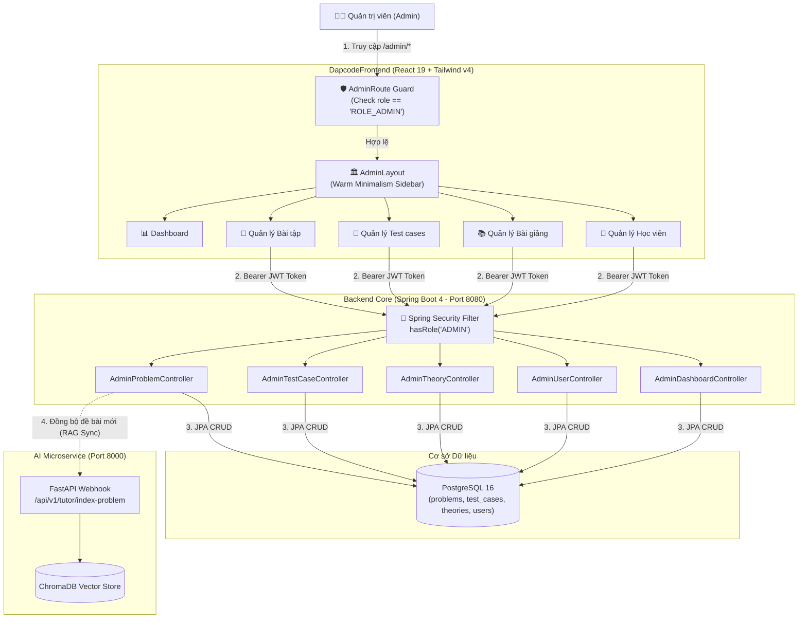

# 📋 KẾ HOẠCH TRIỂN KHAI PHÂN HỆ QUẢN TRỊ VIÊN (ACTOR ADMIN) - DAPCODE

> **Dự án:** Nền tảng luyện thuật toán Dapcode  
> **Tác nhân trọng tâm:** **Actor Admin (Quản trị viên)**  
> **Phạm vi nghiệp vụ:** 4 Use Case cốt lõi (UC4, UC12, UC13, UC14) + Bảng điều khiển giám sát (Admin Dashboard)  
> **Tiêu chuẩn thiết kế giao diện:** Tối giản tinh tế (Warm Minimalism / Editorial Design)

---

## 🏗️ 1. Kiến Trúc Kỹ Thuật & Luồng Phân Quyền (RBAC)



---

## 📅 2. Lộ Trình Triển Khai 5 Giai Đoạn (Task Breakdown)

### 🔹 Giai Đoạn 1: Cơ Sở Dữ Liệu & Tài Khoản Quản Trị Mẫu (Database & Migrations)
- [ ] **Flyway Migration `V9__update_schema_for_admin.sql`:**
  - Bổ sung vào bảng `users`:
    - `is_active BOOLEAN NOT NULL DEFAULT TRUE` (trạng thái khóa/hoạt động).
    - `banned_reason VARCHAR(255)` (lý do khóa tài khoản).
  - Bổ sung vào bảng `problems`:
    - `is_published BOOLEAN NOT NULL DEFAULT TRUE` (cờ xuất bản bài tập công khai hoặc lưu nháp).
  - Bổ sung vào bảng `theories`:
    - `is_published BOOLEAN NOT NULL DEFAULT TRUE` (cờ xuất bản chuyên đề lý thuyết).
- [ ] **Flyway Migration `V10__seed_admin_user.sql`:**
  - Chèn tài khoản Admin mẫu để phục vụ kiểm thử đăng nhập ngay:
    - Email: `admin@dapcode.io`, Username: `admin`, Role: `ROLE_ADMIN`, `is_active: true`.
- [ ] **Cập nhật JPA Entity:**
  - `Users.java`: Thêm thuộc tính `isActive`, `bannedReason`.
  - `Problem.java`: Thêm thuộc tính `isPublished`.
  - `Theories.java`: Thêm thuộc tính `isPublished`.

---

### 🔹 Giai Đoạn 2: Backend Core - Security & Bộ REST API Quản Trị
- [ ] **Bảo Mật & Phân Quyền (SecurityConfig):**
  - Thêm annotation `@EnableMethodSecurity`.
  - Cấu hình phân quyền trong `securityFilterChain`:
    ```java
    .requestMatchers("/api/v1/admin/**").hasRole("ADMIN")
    ```
  - Kiểm tra logic `JwtAuthenticationFilter`: Đảm bảo `ROLE_ADMIN` được cấp quyền truy cập chuẩn xác.

- [ ] **UC13: Quản Lý Bài Tập (`AdminProblemController` & `ProblemService`):**
  - Tạo các DTO: `CreateProblemRequest`, `UpdateProblemRequest`.
  - Viết các endpoints:
    - `POST /api/v1/admin/problems`: Tạo bài tập mới (slug tự sinh hoặc chỉ định, tiêu đề, độ khó, danh mục, thời gian/bộ nhớ chạy, mô tả Markdown, mã khởi đầu Starter Code đa ngôn ngữ).
    - `PUT /api/v1/admin/problems/{id}`: Cập nhật thông tin bài tập.
    - `DELETE /api/v1/admin/problems/{id}`: Xóa bài tập (xử lý xóa mềm hoặc xóa cascade các test cases và submissions).

- [ ] **UC14: Quản Lý Bộ Test Case (`AdminTestCaseController` & `TestCaseService`):**
  - Tạo mới `TestCaseService` & `TestCaseServiceImpl`.
  - Tạo các DTO: `TestCaseDto`, `CreateTestCaseRequest`, `BatchTestCaseRequest`.
  - Viết các endpoints:
    - `GET /api/v1/admin/problems/{problemId}/testcases`: Lấy toàn bộ test cases (gồm cả test case ẩn và công khai).
    - `POST /api/v1/admin/problems/{problemId}/testcases`: Thêm một test case lẻ.
    - `POST /api/v1/admin/problems/{problemId}/testcases/batch`: Import danh sách test cases hàng loạt (hỗ trợ nhập mảng JSON).
    - `PUT /api/v1/admin/testcases/{id}`: Chỉnh sửa input, output hoặc đổi cờ `isHidden`.
    - `DELETE /api/v1/admin/testcases/{id}`: Xóa test case.

- [ ] **UC4: Quản Lý Bài Giảng (`AdminTheoryController` & `TheoryService`):**
  - Mở rộng `TheoryService` với các method: `createTheory`, `updateTheory`, `deleteTheory`.
  - Tạo các DTO: `CreateTheoryRequest`, `UpdateTheoryRequest`.
  - Viết các endpoints:
    - `POST /api/v1/admin/theories`: Tạo bài giảng lý thuyết chuyên đề mới.
    - `PUT /api/v1/admin/theories/{id}`: Cập nhật nội dung bài giảng Markdown, độ khó, thời lượng đọc.
    - `DELETE /api/v1/admin/theories/{id}`: Xóa bài giảng.

- [ ] **UC12: Quản Lý Học Viên (`AdminUserController` & `AdminUserService`):**
  - Tạo DTOs: `AdminUserSummaryDto`, `UpdateUserStatusRequest`, `UpdateUserRoleRequest`.
  - Viết các endpoints:
    - `GET /api/v1/admin/users`: Danh sách học viên có phân trang (`Pageable`), hỗ trợ tìm kiếm theo `username`, `email`, lọc theo `role` và `status`.
    - `GET /api/v1/admin/users/{id}`: Chi tiết học viên (lịch sử nộp, tỷ lệ Accepted, streak, điểm XP).
    - `PUT /api/v1/admin/users/{id}/status`: Khóa tài khoản / Kích hoạt lại tài khoản kèm lý do.
    - `PUT /api/v1/admin/users/{id}/role`: Phân quyền (cấp quyền `ROLE_ADMIN` hoặc hạ xuống `ROLE_USER`).

- [ ] **Bảng Điều Khiển Giám Sát (`AdminDashboardController`):**
  - `GET /api/v1/admin/dashboard/stats`: Thống kê tổng số lượng học viên, số lượng bài tập theo độ khó (Easy/Medium/Hard), tổng lượt nộp bài, tỷ lệ nộp thành công (Accepted Rate), số bài nộp trong 7 ngày qua.

---

### 🔹 Giai Đoạn 3: Đồng Bộ Tri Thức Vector AI (AI Service Sync)
- [ ] Bổ sung endpoint trong `AI-service`:
  - `POST /api/v1/tutor/index-problem`: Nhận payload bài tập mới (slug, title, description, starter_code) và thêm trực tiếp vào collection `NeetCode-150-main` trong ChromaDB.
- [ ] Backend Core tích hợp gọi RestClient sang AI service bất cứ khi nào Admin thêm bài mới hoặc sửa đề bài.

---

### 🔹 Giai Đoạn 4: Frontend Admin Portal (React 19 + Warm Minimalism)

#### 4.1. Thiết Lập Khung Nền Tảng (Core Infrastructure)
- [ ] **API Client:** Tạo file `src/api/admin.js` chứa toàn bộ hàm gọi API quản trị với Axios.
- [ ] **Route Guard:** Tạo `src/components/AdminRoute.jsx` kiểm tra xác thực và quyền `user?.role === 'ROLE_ADMIN'`. Chuyển hướng người dùng thường về `/roadmap` kèm thông báo.
- [ ] **Admin Layout (`src/layouts/AdminLayout.jsx`):**
  - Áp dụng triệt để ngôn ngữ thiết kế **Warm Minimalism**:
    - Nền: `#FDFBF7` (Canvas Warm Cream).
    - Khối thẻ/Sidebar: Nền trắng ngà `#FFFFFF`, viền mảnh sắc nét `#E8E4DC`.
    - Chữ: `#1C1917` (Stone-900) kết hợp `#78716C` (Stone-500).
    - Accent: Amber tinh tế `#D97706` / `#B45309`, tuyệt đối không dùng gradient.
  - Sidebar cố định với các mục menu:
    - 📊 **Tổng quan (Dashboard)**
    - 📝 **Quản lý Bài tập (Problems)**
    - 🧪 **Quản lý Test cases (Test Cases)**
    - 📚 **Quản lý Bài giảng (Theories)**
    - 👥 **Quản lý Học viên (Users)**
- [ ] **Tích hợp Navbar:** Thêm nút/badge "Trang Quản Trị" trên `Navbar.jsx` khi người dùng đăng nhập có `role === 'ROLE_ADMIN'`.
- [ ] **Cập nhật Định tuyến (`App.jsx`):** Đăng ký cụm route `/admin/*`.

#### 4.2. Xây Dựng Các Màn Hình Chức Năng (Admin Pages)
- [ ] **1. `AdminDashboardPage.jsx`:**
  - 4 Cards số liệu chính: Tổng học viên, Tổng bài tập, Lượt nộp bài, Tỷ lệ nộp thành công.
  - Biểu đồ nộp bài 7 ngày gần nhất (sử dụng SVG hoặc Recharts tối giản).
  - Bảng top 5 bài nộp gần đây nhất.
- [ ] **2. `AdminProblemsPage.jsx` (UC13):**
  - Bảng danh sách bài tập (tìm kiếm, lọc category, filter độ khó, phân trang).
  - Nút "Thêm bài tập mới" mở Modal/Drawer soạn thảo:
    - Tích hợp ô nhập Title, Slug, Category, Difficulty, Limits.
    - Markdown Editor (soạn thảo đề bài + Xem trước Tab Preview).
    - Tab nhập Starter Code cho 3 ngôn ngữ: Python, Java, C++.
  - Nút Sửa và Nút Xóa bài tập (Modal xác nhận bảo vệ dữ liệu).
  - Nút thao tác nhanh: "Quản lý Test case" chuyển thẳng đến bài tập tương ứng.
- [ ] **3. `AdminTestCasesPage.jsx` (UC14):**
  - Dropdown chọn bài tập cần cấu hình test case.
  - Danh sách test cases: Badge hiển thị "Công Khai" hoặc "Ẩn".
  - Form thêm mới test case:
    - Textarea Input Data & Expected Output.
    - Switch toggle "Test case ẩn (Hidden)".
  - Chức năng "Import hàng loạt" bằng JSON.
- [ ] **4. `AdminTheoriesPage.jsx` (UC4):**
  - Bảng danh sách chuyên đề lý thuyết DSA theo danh mục.
  - Modal tạo/chỉnh sửa bài giảng Markdown với live preview.
- [ ] **5. `AdminUsersPage.jsx` (UC12):**
  - Bảng danh sách tài khoản học viên (Avatar, Username, Email, Role, XP, Streak, Ngày tham gia).
  - Nút đổi quyền tài khoản (ROLE_USER $\leftrightarrow$ ROLE_ADMIN).
  - Nút Khóa / Mở khóa tài khoản học viên (kèm ô nhập lý do).

---

### 🔹 Giai Đoạn 5: Tài Liệu Phân Tích & Thiết Kế (UML / BCE Diagrams)
- [ ] Xây dựng file đặc tả ca sử dụng `usecase_specifications_admin.md` theo chuẩn RUP/IEEE:
  - Bản đặc tả chi tiết 4 Use Case: UC4, UC12, UC13, UC14 (Mục đích, Tác nhân, Tiền điều kiện, Luồng sự kiện chính, Luồng ngoại lệ, Hậu điều kiện).
- [ ] **Biểu đồ lớp phân tích (BCE - Boundary, Control, Entity):**
  - **UC4:** `QuanLyBaiGiangUI` $\leftrightarrow$ `QuanLyBaiGiangController` $\leftrightarrow$ `Theories`, `Admin`
  - **UC12:** `QuanLyHocVienUI` $\leftrightarrow$ `QuanLyHocVienController` $\leftrightarrow$ `Users`, `Admin`
  - **UC13:** `QuanLyBaiTapUI` $\leftrightarrow$ `QuanLyBaiTapController` $\leftrightarrow$ `Problem`, `Admin`
  - **UC14:** `QuanLyTestCaseUI` $\leftrightarrow$ `QuanLyTestCaseController` $\leftrightarrow$ `TestCase`, `Problem`, `Admin`
- [ ] **Biểu đồ trình tự (Sequence Diagrams):** Mô hình hóa tương tác tin nhắn giữa các đối tượng BCE cho từng kịch bản CRUD.

---

## 🧪 3. Kế Hoạch Kiểm Thử & Tiêu Chí Nghiệm Thu (Acceptance Criteria)

| Phân hệ | Kịch bản kiểm thử | Kết quả kỳ vọng |
| :--- | :--- | :--- |
| **Bảo mật (RBAC)** | Học viên thường (`ROLE_USER`) gửi request tới `/api/v1/admin/**` hoặc mở `/admin` trên trình duyệt. | Backend trả về `403 Forbidden`, Frontend chặn và chuyển hướng về `/roadmap`. |
| **Quản lý Bài tập** | Admin tạo bài tập mới với mô tả Markdown và 3 bộ starter code. | Bài tập được lưu vào DB, xuất hiện ngay trong danh sách bài tập của học viên và trên cây Roadmap. |
| **Quản lý Test case** | Admin thêm 2 test case công khai và 3 test case ẩn cho bài tập vừa tạo. | Khi học viên nộp bài, hệ thống chấm đúng cả 5 test cases; trong giao diện kết quả chỉ hiển thị chi tiết 2 test case công khai. |
| **Quản lý Học viên** | Admin khóa tài khoản của 1 học viên vi phạm. | Học viên đó bị thu hồi quyền nộp bài và nhận thông báo tài khoản bị khóa. |
| **Quản lý Bài giảng** | Admin thêm bài lý thuyết mới cho chuyên đề "Dynamic Programming". | Bài giảng xuất hiện chuẩn đẹp trong danh mục lý thuyết và hiển thị đúng định dạng Markdown. |
| **Giao diện UI/UX** | Trải nghiệm toàn bộ trang Admin trên desktop và tablet. | Màu sắc chuẩn Warm Minimalism, không gradient, không lỗi hiển thị, mượt mà và trực quan. |
